<p align="center">
  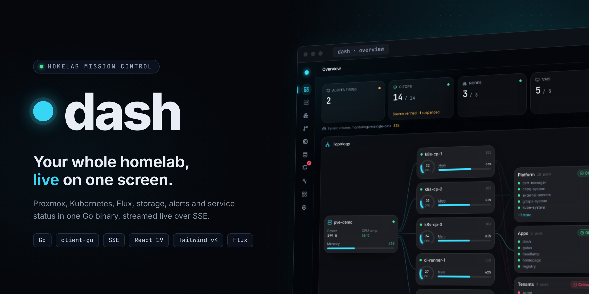
</p>

# dash

Homelab mission control.

dash is one Go binary that serves a web UI and a live API over the Linux hosts you can reach with
SSH, Proxmox, Kubernetes, Flux, server hardware, storage, Alertmanager and Gatus. Each integration
is a plugin that turns on when its settings are complete; nothing about a particular lab is
compiled in. It runs as a systemd service, as a container or in a Kubernetes cluster, for example
behind an oauth2-proxy sidecar that admits only the users you list.

**[Open the live demo](https://dash.techdufus.com/demo/)**: the real web UI on recorded demo
data, in your browser, with nothing to install.

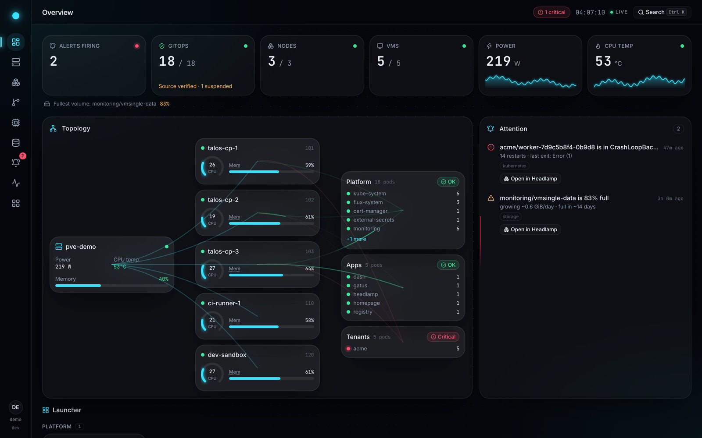

| | |
|:---:|:---:|
| 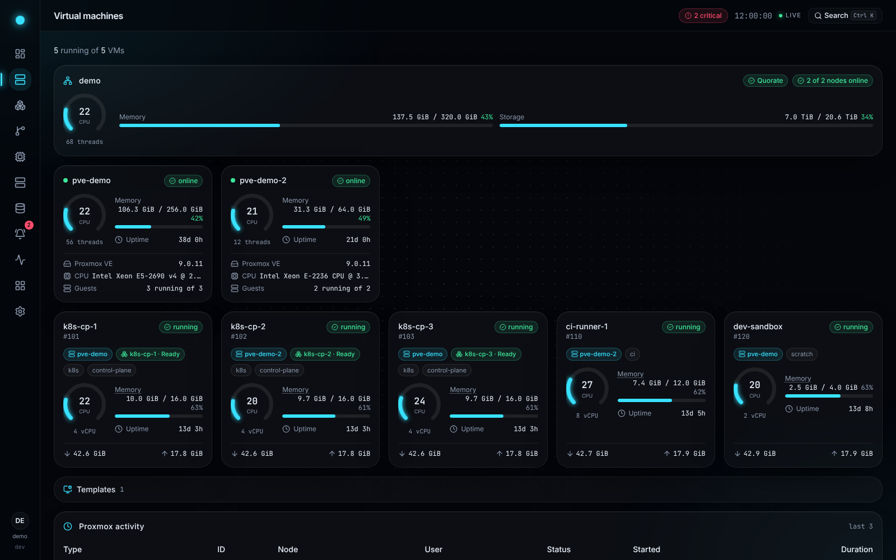 **Virtual machines** | 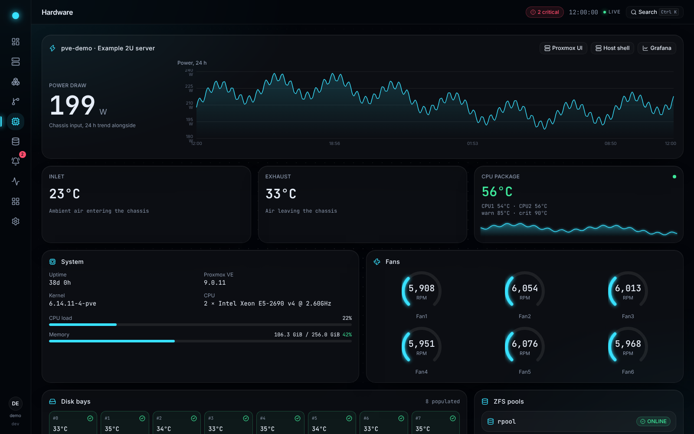 **Hardware** |
| 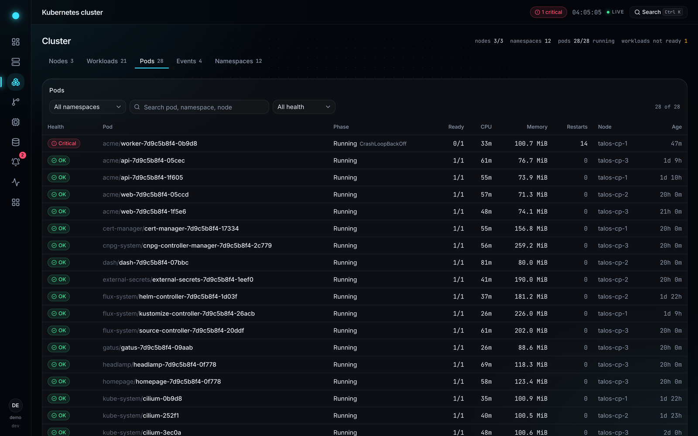 **Cluster** | 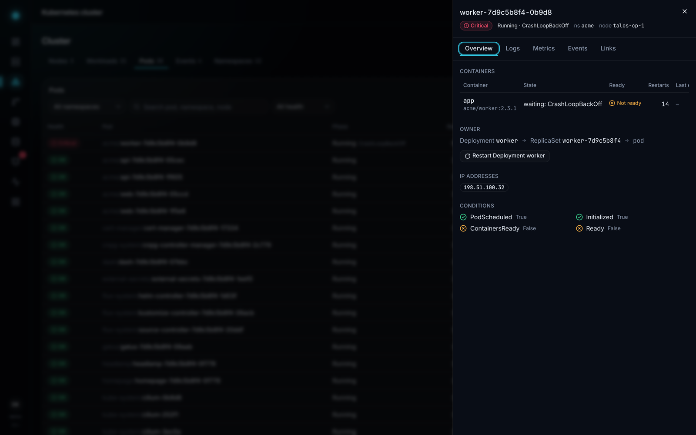 **Pod detail** |
| 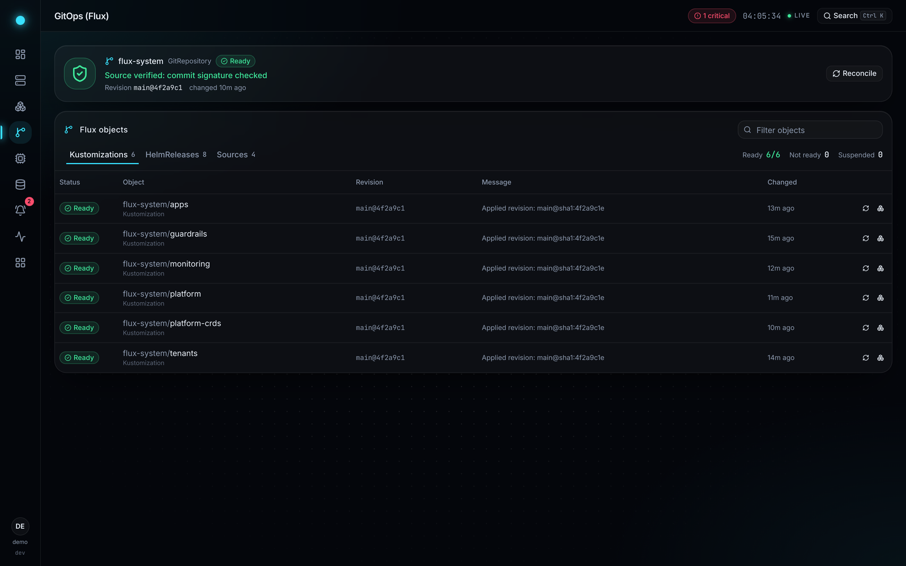 **GitOps** | 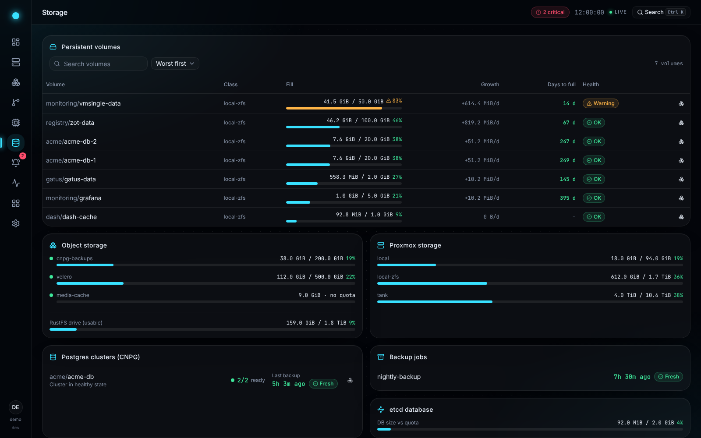 **Storage** |

<details>
<summary><b>More screenshots</b></summary>

| | |
|:---:|:---:|
| 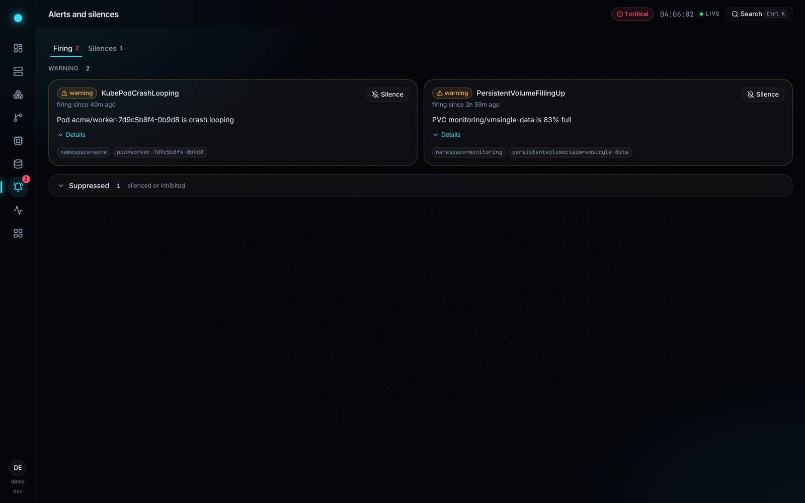 **Alerts and silences** | 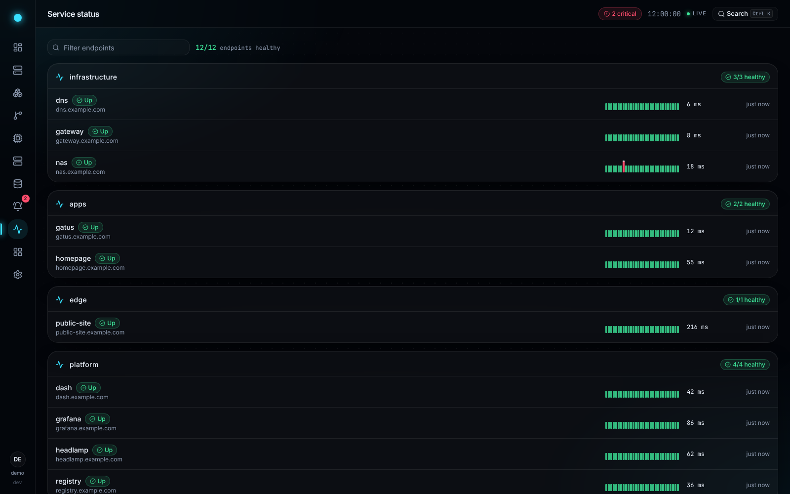 **Service status** |
| 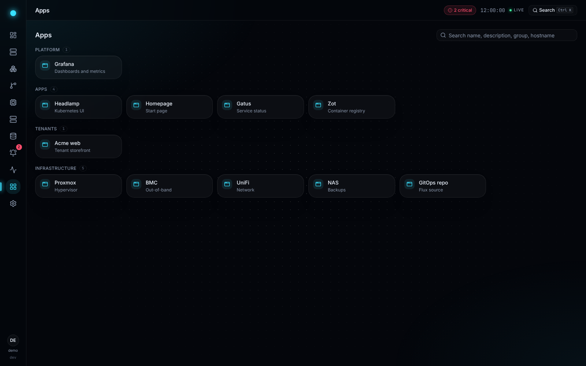 **Apps** | 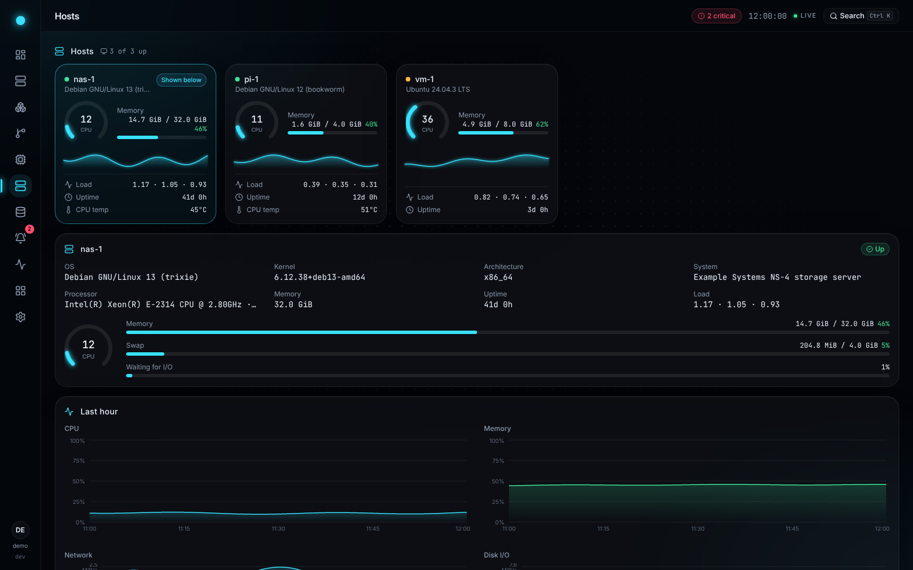 **Hosts** |

</details>

Every screenshot comes from the built-in demo mode at a fixed clock; every name and address in
them is made up.

## Features

The Overview rolls alerts, GitOps, nodes, VMs, power and CPU temperature into a KPI row, draws the
topology from the Proxmox host through its VMs to every namespace, and lists what needs attention,
worst first. A command palette (`Ctrl K`) jumps to any page, host, VM, node, workload or pod. The
data is live: only what changed goes out over a single server-sent event stream. Over HTTPS a
browser can [install dash as an app](docs/app.md), on a phone's home screen too.

- [SSH hosts](docs/plugins/ssh.md): any Linux machine, added by its address and a user, with
  nothing installed on it: live CPU, memory, network and disk charts, temperatures and fans, file
  systems, disks and ZFS pools, containers and systemd services.
- [Proxmox VE](docs/plugins/proxmox.md): VMs with their Kubernetes node, config, snapshots and
  charts, a link to each console, and the Proxmox storage.
- [Hardware](docs/plugins/hardware.md): IPMI power, temperatures, fans and PSUs, ZFS pools and
  per-bay SMART health, and machines outside the cluster as up or down.
- [Kubernetes](docs/plugins/kubernetes.md): nodes, workloads, pods with logs and metrics, events,
  namespaces, certificates and External Secrets; PVC fill and growth with days-to-full, the age
  of the backup CronJobs you name and the etcd size; the apps behind HTTP routes; a rollout
  restart. Without a cluster dash still serves the rest, and the cluster pages are hidden.
- [Flux](docs/plugins/flux.md): every source, Kustomization and HelmRelease with its revision and
  signature verification; a reconcile request.
- [CloudNativePG](docs/plugins/cnpg.md): Postgres clusters and the age of their last backup.
- [RustFS](docs/plugins/rustfs.md): buckets and capacity of an object store.
- [Alertmanager](docs/plugins/alertmanager.md): firing alerts, and silences that expire.
- [Gatus](docs/plugins/gatus.md): endpoint health, grouped, critical groups first.
- [VictoriaLogs](docs/plugins/victorialogs.md): pod logs and a live tail.
- [Prometheus-compatible](docs/plugins/prometheus.md): the series behind the charts, KPIs and host
  metrics, from VictoriaMetrics or Prometheus.
- [Grafana](docs/plugins/grafana.md) and [Headlamp](docs/plugins/headlamp.md): deep links from the
  object you are looking at.
- [Launcher](docs/plugins/launcher.md): links to your infrastructure.

The Storage page shows the panels of the plugins that run and says so when none of them does.
dash writes in three places only, each off until you turn it on: the rollout restart, the
reconcile request and the silences. It reads hosts over SSH and never changes them
([security model](docs/security.md)).

## Quick start

**Look first.** The [live demo](https://dash.techdufus.com/demo/) is a recording: you can open
every page, and nothing can be changed. For a demo whose actions answer, run demo mode: no
cluster, no credentials, every plugin serving a small, made-up homelab.

```sh
docker run --rm -p 8080:8080 -e DASH_DEMO=true -e DASH_SERVER_LISTEN=0.0.0.0:8080 ghcr.io/techdufus/dash:0.17.0
```

Open http://127.0.0.1:8080. `http://localhost:8080` loads the pages too, but its writes (restart,
reconcile, silences) are refused as `csrf_failed`: dash accepts writes only from its public URL,
which in demo mode defaults to the listen address. To browse at `localhost`, add
`-e DASH_SERVER_PUBLIC_URL=http://localhost:8080`.

**A Linux server.** One command installs the binary as a systemd service, creates its secret key
and prints the link where you set the administrator's password:

```sh
curl -fsSL https://dash.techdufus.com/install.sh | sudo sh
```

It needs systemd and nothing else; run it again to upgrade. [The binary guide](docs/deploy/binary.md)
says what it creates, how to do the same by hand and how to verify the download. Then open
Settings → SSH hosts and [add your first host](docs/plugins/ssh.md): an address, a user and one
line in that user's `authorized_keys`.

**Docker.** Pull the image `ghcr.io/techdufus/dash` (linux/amd64 and linux/arm64) and run it:

```sh
docker pull ghcr.io/techdufus/dash:0.17.0
mkdir -p -m 0700 secrets && openssl rand -base64 32 > secrets/dash_secret_key && chmod 0644 secrets/dash_secret_key
docker run -d --name dash -p 127.0.0.1:8080:8080 -v dash-data:/data \
  -v "$PWD/secrets/dash_secret_key:/run/secrets/dash_secret_key:ro" \
  -e DASH_SECRET_KEY_FILE=/run/secrets/dash_secret_key \
  -e DASH_SERVER_PUBLIC_URL=http://localhost:8080 \
  ghcr.io/techdufus/dash:0.17.0
docker logs dash 2>&1 | grep -m1 'setup token'   # open its url to set the password
```

**Docker Compose**, with Prometheus and Alertmanager under the `monitoring` profile:

```sh
cd examples/compose
mkdir -p -m 0700 secrets && openssl rand -base64 32 > secrets/dash_secret_key && chmod 0644 secrets/dash_secret_key
docker compose --profile monitoring up -d
docker compose logs dash 2>&1 | grep -m1 'setup token'
```

After setup, set Settings → Prometheus → URL to `http://prometheus:9090`.

**Kubernetes**, with the Helm chart `oci://ghcr.io/techdufus/charts/dash` (its version is the
dash version it runs):

```sh
kubectl create namespace dash
openssl rand -base64 32 | kubectl -n dash create secret generic dash-secret-key --from-file=secretKey=/dev/stdin
helm install dash oci://ghcr.io/techdufus/charts/dash --version 0.17.0 --namespace dash \
  --set secretKey.existingSecret=dash-secret-key --set config.server.publicURL=https://dash.example.com
```

To install from a checkout instead, use `charts/dash` in place of the OCI reference
([details](docs/deploy/kubernetes.md)).

The deploy guides cover each path in full: [the binary and systemd](docs/deploy/binary.md),
[Docker and Compose](docs/deploy/docker.md), [Kubernetes](docs/deploy/kubernetes.md) (Helm,
kustomize, RBAC, the oauth2-proxy sidecar) and [other platforms](docs/deploy/paas.md).

## Documentation

- [Configuration](docs/configuration.md): the config file, the variables and every setting.
- [Sign-in](docs/auth.md): the `local`, `oidc`, `proxy` and `none` modes.
- [Settings page](docs/settings.md): what an administrator can change from the UI.
- [Installing dash as an app](docs/app.md): the PWA, iOS and rolling back.
- [MCP server and context bundles](docs/mcp.md): read-only access for AI agents, and
  "Copy context for AI".
- [Connecting MCP clients](docs/agents/mcp.md): Claude Code, Claude Desktop and claude.ai, VS Code
  and omp, and [the dash skill](docs/agents/dash-skill/SKILL.md) for agents.
- [The Android app contract](docs/clients/android.md): what the native app (not released yet)
  needs from dash.
- [Push notifications](docs/push.md): Web Push and UnifiedPush to the devices in Settings → Devices.
- [Security model](docs/security.md), and how to report a vulnerability: [SECURITY.md](SECURITY.md).
- Deploy: [the binary and systemd](docs/deploy/binary.md), [Docker](docs/deploy/docker.md),
  [Kubernetes](docs/deploy/kubernetes.md), [other platforms](docs/deploy/paas.md).
- [Plugins](docs/plugins/README.md): what each one shows, needs and may do.
- [Operations](docs/operations.md): health probes, metrics, the secret key and the audit log.
- [Upgrading](docs/upgrading.md): changes that matter when you upgrade from an old release.
- [HTTP API](docs/api/README.md) and its [OpenAPI document](docs/api/openapi.json).
- [Development](docs/development.md): dev mode, checks, generated files, screenshots, releases.
- [Third-party notices](THIRD_PARTY_NOTICES.md).

## Development

Tools are pinned in `mise.toml` (`mise install`). [CONTRIBUTING.md](CONTRIBUTING.md) says how a
change gets in.

```sh
DASH_DEMO=true make dev-api   # the Go API on 127.0.0.1:8080, on demo data
make dev-web                  # Vite on http://localhost:5173
make generate                 # rewrite the generated files after a change
make check                    # what CI's check job runs
make scan                     # secret, vulnerability and workflow scans, and the web links
make demo                     # the static demo the landing page hosts, recorded and checked
```

Without make, build the SPA first, since it is embedded at build time:
`cd web && npm ci --ignore-scripts && npm run build && cd .. && DASH_DEMO=true go run ./cmd/dash`.
[docs/development.md](docs/development.md) has the rest: a real cluster, busy ports, the generated
files, the screenshots, the static demo and the pre-push hook.

## License

MIT. See [LICENSE](LICENSE). The third-party software dash includes, and its licences, are listed
in [THIRD_PARTY_NOTICES.md](THIRD_PARTY_NOTICES.md).
